<div align="center">

# Claims Desk

**One place to file, review and settle motor and property claims across six APAC markets.**
.NET 8 API + Angular 17 SPA, with an event pipeline that runs **with or without Kafka** from a single config switch.


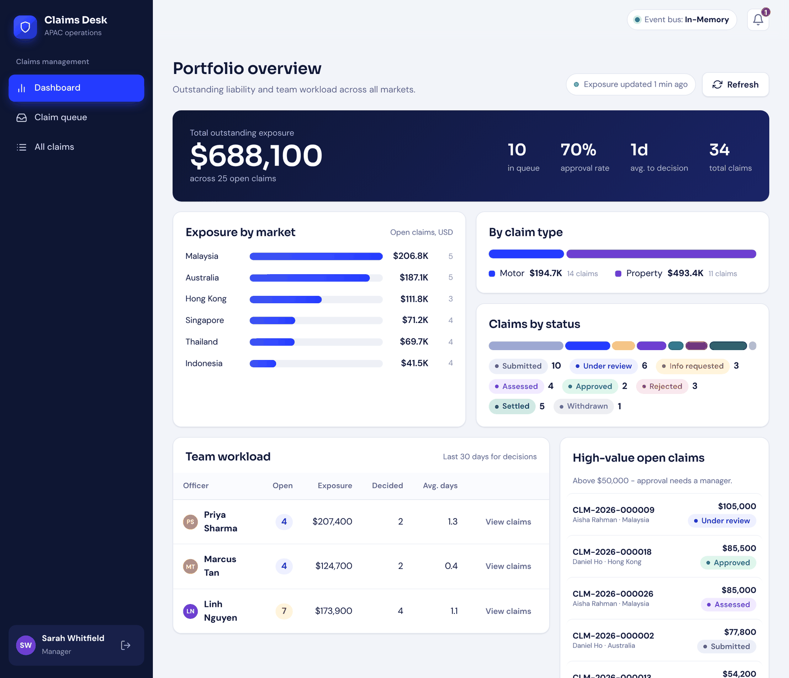

<sub>Manager dashboard. Screenshots in this README are the real Angular build running against a stand-in API with demo data (see [note on screenshots](#a-note-on-the-screenshots)).</sub>

</div>

---

## Contents

1. [What it does](#what-it-does)
2. [How it works, in one picture](#how-it-works-in-one-picture)
3. [The claim lifecycle](#the-claim-lifecycle)
4. [Quick start](#quick-start)
5. [Demo accounts and a 3-minute tour](#demo-accounts-and-a-3-minute-tour)
6. [Test scoreboard](#test-scoreboard)
7. [API reference](#api-reference)
8. [Configuration](#configuration)
9. [Project layout](#project-layout)
10. [Known shortcuts](#known-shortcuts)
11. [Further reading](#further-reading)

---

## What it does

Three kinds of people use the app, and each one gets a different home screen and a different set of buttons.

| Persona | Goal | What they can do |
|---|---|---|
| **Claimant** (policyholder) | Get a claim paid | File a claim, follow its progress, answer information requests, upload PDF/JPEG/Word evidence when requested, withdraw before assessment |
| **Claims officer** | Work a queue of claims | Pick up claims, request information, record an assessment, approve up to $50,000, reject with a reason, settle, add internal notes |
| **Claims manager** | Keep the portfolio healthy | Everything an officer can do on any claim, plus reassign, approve above $50,000 (four-eyes rule), and see portfolio exposure and team workload |

<table>
  <tr>
    <td width="50%">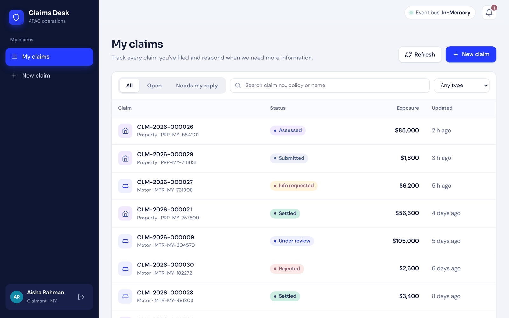<br><sub><b>Claimant</b>: my claims</sub></td>
    <td width="50%">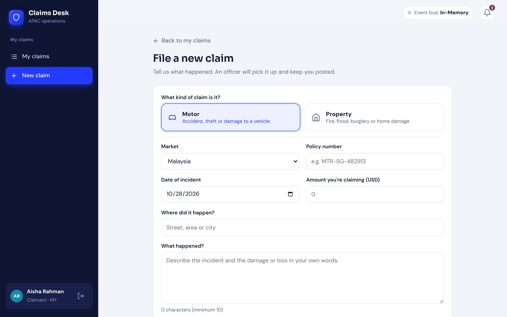<br><sub><b>Claimant</b>: file a new claim</sub></td>
  </tr>
  <tr>
    <td width="50%">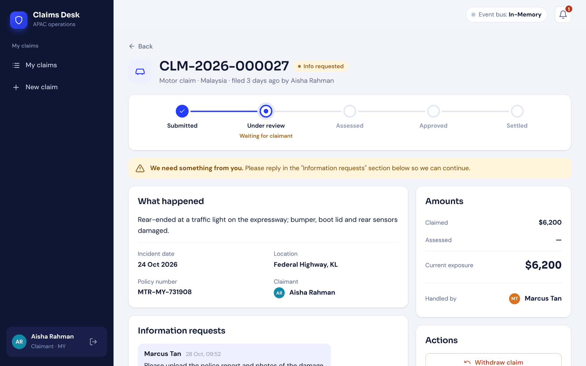<br><sub><b>Claimant</b>: the officer asked for more information</sub></td>
    <td width="50%">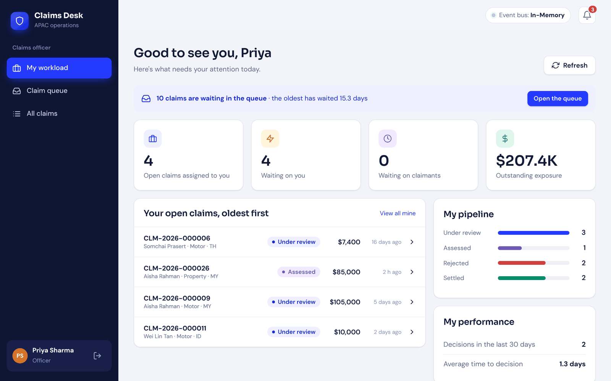<br><sub><b>Officer</b>: my workload</sub></td>
  </tr>
  <tr>
    <td width="50%">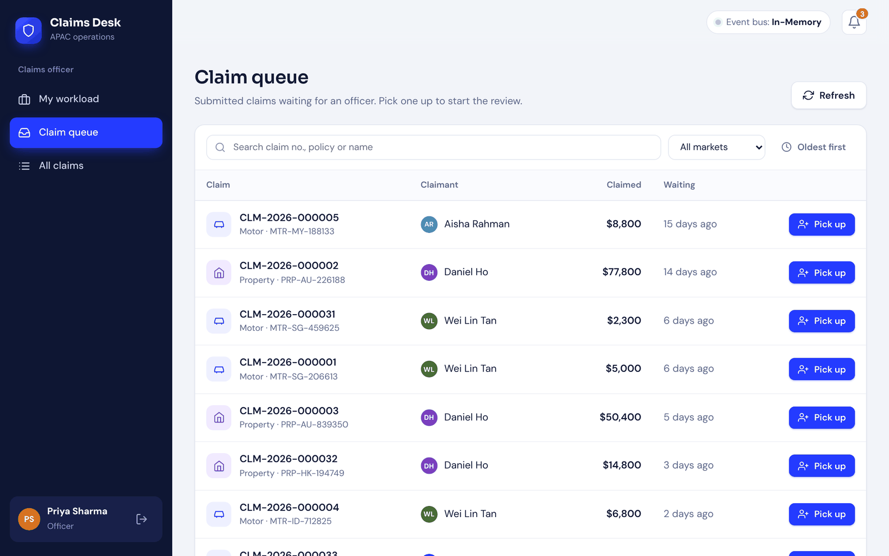<br><sub><b>Officer</b>: the queue, oldest first</sub></td>
    <td width="50%">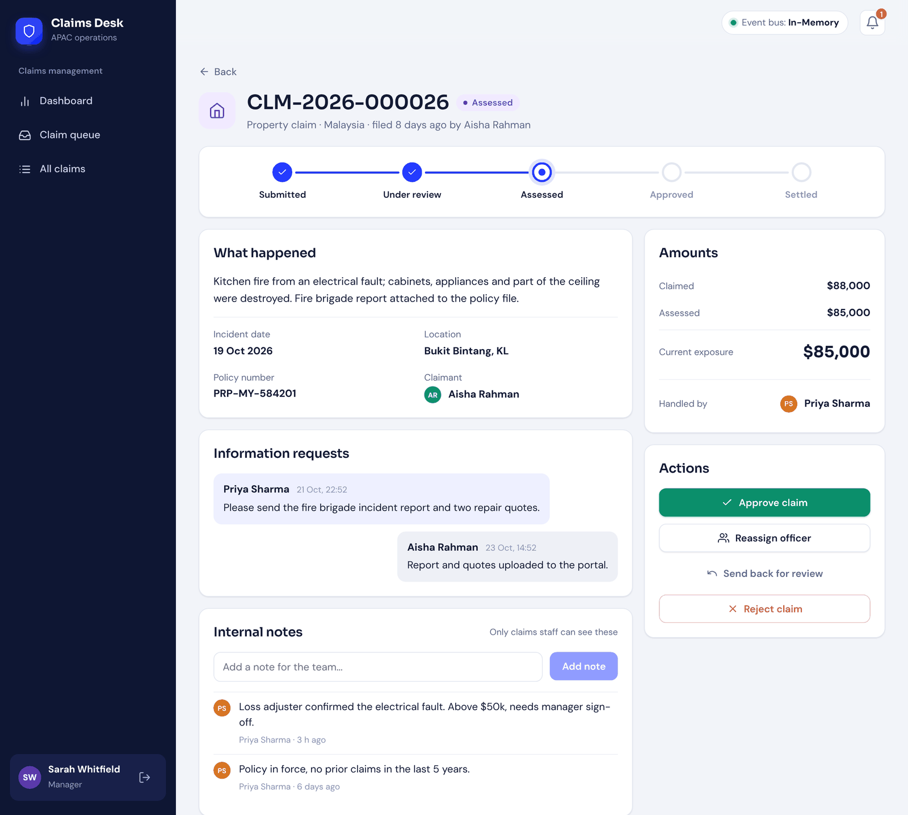<br><sub><b>Manager</b>: a high-value claim waiting for sign-off</sub></td>
  </tr>
</table>

### Features worth knowing about

- **Buttons come from the server.** The API returns `availableActions` for the signed-in user on every claim, and the UI draws exactly those buttons. Authorisation rules live in one place.
- **Four-eyes rule.** Approving more than $50,000 needs a manager.
- **Supporting documents.** When staff request more information, claimants can upload PDF, JPEG, DOC, or DOCX files (up to 10 MB each); staff can view/download submitted files from the claim detail page. File bytes live in persistent storage and metadata is kept with the claim.
- **Full audit trail.** Every status change writes a history row with who, when and why.
- **Lost updates are caught.** Each claim carries a `Version`; a stale write returns `409` instead of overwriting.
- **Notifications and exposure numbers are asynchronous.** They are produced by event consumers, not by the request that caused them.
- **Works offline from Kafka.** The default in-memory bus needs no infrastructure; flip one setting to use a real broker.

---

## How it works, in one picture

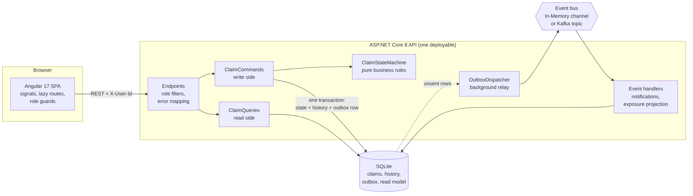

The important idea is the **transactional outbox**. When an officer approves a claim, the claim change, its history row and the event to publish are saved in *one* database transaction. A background relay then ships the event. If Kafka is down, nothing is lost: the event simply waits in the outbox.

<details>
<summary><b>See the same flow as a sequence (approve a claim)</b></summary>

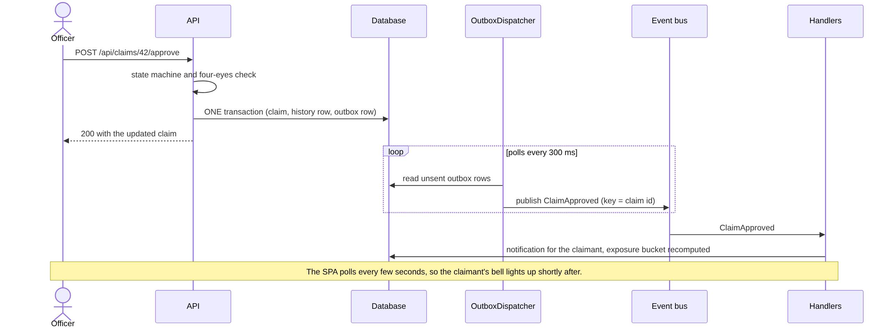

</details>

Full reasoning, trade-offs and what changes in production: **[docs/ARCHITECTURE.md](docs/ARCHITECTURE.md)**.

---

## The claim lifecycle

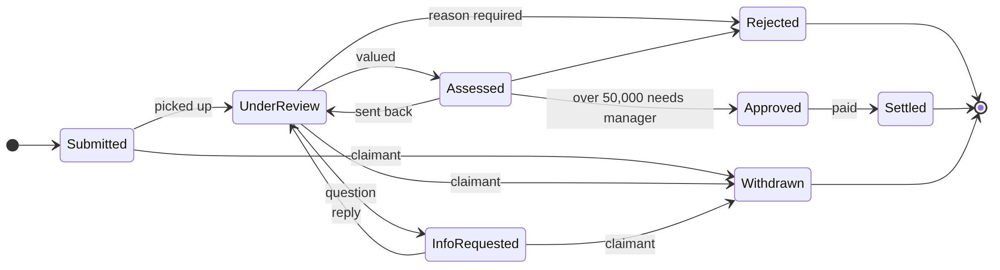

Twelve legal transitions, no more. Anything else returns `409 Conflict`. Rejected, Settled and Withdrawn are final.

**Outstanding exposure** of an open claim is `approved amount`, else `assessed amount`, else `claimed amount`. It drops out of the totals the moment the claim is settled, rejected or withdrawn.

---

## Quick start

**You need:** .NET 8 SDK, Node 18.19+ or 20+, and Docker only if you want Kafka.

### Without Kafka (default, zero setup)

```bash
# terminal 1: API on http://localhost:5080  (Swagger UI at the root)
cd backend/src/ClaimsPlatform.Api
dotnet run

# terminal 2: SPA on http://localhost:4200
cd frontend
npm install
npm start
```

The SQLite database (`claims.db`) is created and seeded on first start with 8 demo users and 30 claims across every status. Delete the file to reset.

### With Kafka

```bash
docker compose up -d                      # single-node Kafka (KRaft) on localhost:9092

cd backend/src/ClaimsPlatform.Api
dotnet run --launch-profile Kafka         # or: Messaging__Provider=Kafka dotnet run
```

The top bar of the UI shows which bus is active (`Event bus: Kafka` or `Event bus: In-Memory`). If Kafka goes down, the API keeps working and events wait in the outbox until the broker is back.

### Troubleshooting

| Symptom | Likely cause |
|---|---|
| Login page says "Can't reach the backend" | API is not running on `http://localhost:5080`, or `npm start` was not used (it carries the proxy config) |
| Browser blocks calls with a CORS error | The SPA must be served from `http://localhost:4200` or `http://127.0.0.1:4200` |
| Data looks stale or corrupted after experiments | Stop the API and delete `claims.db`, `claims.db-shm`, `claims.db-wal` |
| Bell never updates with Kafka selected | Broker not reachable yet; check `docker compose ps`. The API logs "Kafka not reachable ... Retrying in 3s" |

---

### Run the complete app with Docker

From the repository root, run:

```bash
docker compose up --build
```

Then open **http://localhost:4200**. The API and Swagger are available at **http://localhost:5080/swagger**. The `claims-data` Docker volume persists the SQLite database and uploaded documents across container restarts. Stop the stack with `docker compose down`; use `docker compose down -v` only if you intentionally want to delete that persisted demo data.

The backend can also be built alone from the repository root with `docker build -f backend/src/ClaimsPlatform.Api/Dockerfile -t claims-platform-api .`.

## Demo accounts and a 3-minute tour

Pick any account on the login screen (no password; this is demo auth).

| Role | Who | Home screen |
|---|---|---|
| Claimant | Aisha Rahman (MY), Wei Lin Tan (SG), Somchai Prasert (TH), Daniel Ho (HK) | My claims |
| Officer | Priya Sharma, Marcus Tan, Linh Nguyen | My workload |
| Manager | Sarah Whitfield | Portfolio dashboard |

<p align="center">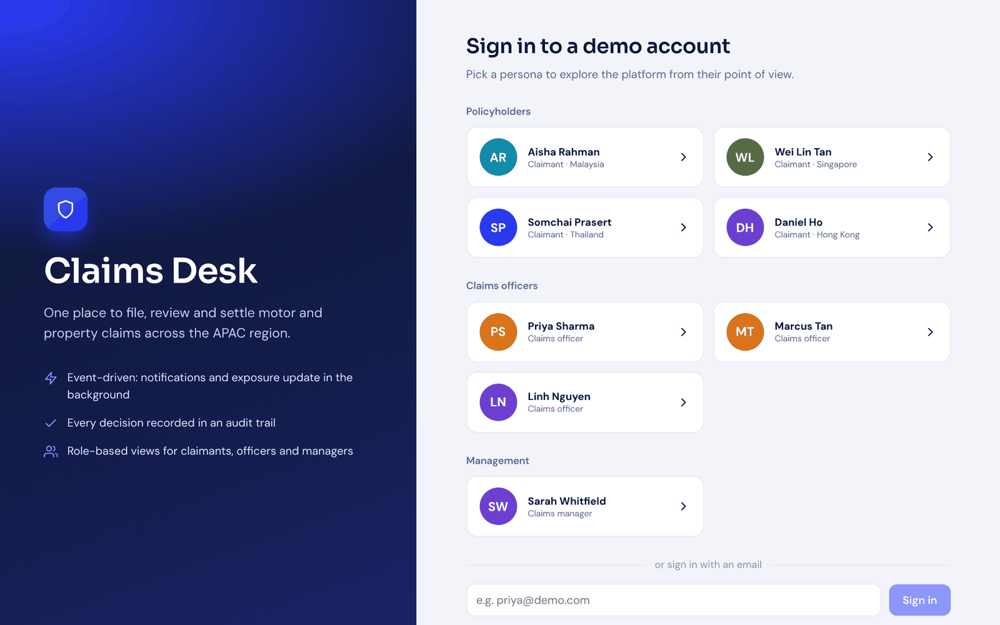</p>

1. Sign in as **Aisha**, choose *New claim*, submit. Note the claim number.
2. Open a second private window and sign in as **Priya**. Her bell shows a message such as "New Motor claim CLM-2026-000031 in the MY queue" (the type and market are whatever Aisha chose). That message was produced by the event consumer, not by Aisha's request.
3. Priya: *Claim queue*, **Pick up**, then *Request information*.
4. Aisha: the bell lights up. Open the claim and **reply**.
5. Priya: *Record assessment*, *Approve*, *Settle*. Try approving more than $50,000: blocked, a manager must do it.
6. **Sarah**: the dashboard exposure updates within seconds. Reassign a claim to see the audit trail grow.

---

## Test scoreboard

> Measured on **28 October 2026**. Everything below was executed, not estimated, with the exceptions called out in the footnotes.

| | Tests | Passed | Failed | **Pass rate** |
|---|---:|---:|---:|---:|
| Frontend (Angular, Karma + Jasmine, headless Chrome) | 388 | 388 | 0 | **100%** |
| Backend (xUnit tests, 64 test methods expanded from data rows) | 192 | 192 | 0 | **100%** |
| **Total** | **580** | **580** | **0** | **100%** |

### Code coverage

| | Statements | Branches | Functions | Lines |
|---|---:|---:|---:|---:|
| **Frontend**, all 22 source files | **100%** (573 / 573) | **100%** (169 / 169) | **100%** (219 / 219) | **100%** (467 / 467) |
| **Backend**, whole project (see note below) | **6.4%** (38 / 593) | not measured | not measured | not measured |
| Backend, the layers its tests can reach (domain, DTOs, event contract) | **100%** (38 / 38) | not measured | not measured | not measured |

**Read the backend number carefully.** The 192 backend tests all pass and they cover the pure business logic completely: every status transition, every role-by-status permission, the four-eyes threshold, exposure rules, enum contracts the SPA relies on, and the Kafka event wire format. But the code that talks to the database, HTTP and Kafka has **no automated tests yet**, which is why project-wide coverage is only 6.4%. The map below shows where the gap is.

```
Backend statement coverage by file                     covered / total
Domain/ClaimStateMachine.cs     ##########  100%       34 / 34
Domain/Entities.cs              ##########  100%        1 / 1
Infrastructure/Events.cs        ##########  100%        3 / 3
Application/ClaimCommands.cs    ..........    0%        0 / 140   needs a database
Infrastructure/Messaging.cs     ..........    0%        0 / 105   needs Kafka or a stub bus
Endpoints/ApiEndpoints.cs       ..........    0%        0 / 75    needs the web host
Application/ClaimQueries.cs     ..........    0%        0 / 69    needs a database
Infrastructure/Seeder.cs        ..........    0%        0 / 62    needs a database
Infrastructure/Handlers.cs      ..........    0%        0 / 56    needs a database
Infrastructure/ClaimsDbContext.cs ........    0%        0 / 43    needs a database
Program.cs                      ..........    0%        0 / 5     composition root
```

> **Note on the 6.4%:** statement coverage measured by instrumenting all 13 backend `.cs` files; 11 of them contain executable statements (593 in total). `Enums.cs` and `Dtos.cs` hold only declarations, so they contribute none; their shape is still checked by `DomainModelTests`.

### What the tests are made of

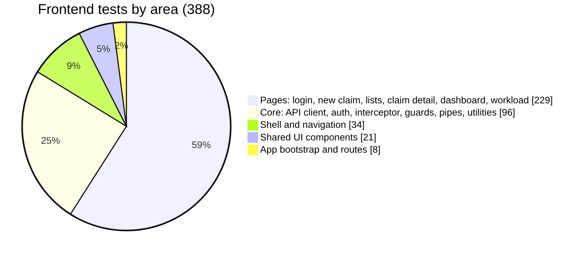

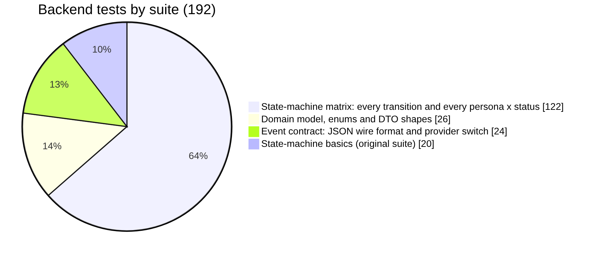

| Suite | File | Tests |
|---|---|---:|
| State-machine matrix | `ClaimStateMachineMatrixTests.cs` | 122 |
| State-machine basics (already in the repo) | `ClaimStateMachineTests.cs` | 20 |
| Domain model, enums, DTOs | `DomainModelTests.cs` | 26 |
| Event contract | `EventContractTests.cs` | 24 |

### Do the tests actually catch bugs?

A passing suite proves little if it could never fail. So deliberate bugs were injected, one at a time, and the suite was checked to go red each time.

| Suite | Bugs injected | Caught | Examples |
|---|---:|---:|---|
| Frontend | 12 | **12** | four-eyes threshold changed, role guard inverted, polling slowed 10x, 401 handling checks the wrong status |
| Backend | 11 | **11** | an approved claim made rejectable, officers allowed to reassign, enum JSON written as numbers, an event renamed on the wire |

### Run them yourself

```bash
# Frontend: 388 specs, headless, with coverage report
cd frontend
npm install
npm run test:ci                       # report: frontend/coverage/claims-portal/index.html
                                      # needs Chrome/Chromium (set CHROME_BIN if it is not on PATH)

# Backend: 192 tests
cd backend
dotnet test
dotnet test --collect:"XPlat Code Coverage"   # coverlet is already referenced in the test project
```

<details>
<summary><b>How these numbers were produced (and what is different from a normal run)</b></summary>

<br>

**Frontend.** `ng test` with Karma, Jasmine and `karma-coverage` (Istanbul) in headless Chromium, using the `ChromeHeadlessCI` launcher defined in `frontend/karma.conf.js`. Specs run in random order. The shared test helper in `src/testing/` is excluded from coverage so it cannot inflate the figure. Result: `Executed 388 of 388 SUCCESS`.

**Backend.** The machine used to write these tests could not download NuGet packages (no route to the package feed), so `dotnet test` with xUnit, EF Core and Kafka could not be restored there. To still *run* the tests rather than just write them, the same test files were compiled unchanged against a small xUnit-compatible shim (`Fact`, `Theory`, `InlineData`, `MemberData` and `Assert.*`) together with the production files that depend only on the .NET base library: `Domain/*`, `Application/Dtos.cs` and `Infrastructure/Events.cs`. All 64 test methods (192 cases) passed.

Because coverlet was not available either, statement coverage for the backend was measured with a small Roslyn-based instrumenter that puts a probe in front of every executable statement of all 13 production files. That is *statement* coverage, close to but not identical to coverlet's *line* coverage. Branch and function coverage were not measured.

**What to do on your machine.** Run `dotnet test` once. The tests were written to be plain xUnit 2.x and should pass unchanged, but the first real run is the confirmation. `dotnet test --collect:"XPlat Code Coverage"` then gives the official coverlet number, which should be in the same region as 6.4%.

</details>

### What would raise the backend number

The remaining 555 statements need a real database and, for messaging, a broker. The recommended next step is **API integration tests** using `WebApplicationFactory<Program>` (the app already exposes `public partial class Program`) with an in-memory SQLite connection, plus a **Testcontainers** Kafka test for the outbox. Those would exercise `ClaimCommands`, `ClaimQueries`, the endpoints, the handlers and the dispatcher end to end. They were deliberately *not* added here because they could not be run, and a test that has never been seen to pass is not worth committing.


---

## API reference

Interactive docs live at `http://localhost:5080/swagger`. Authentication is the `X-User-Id` header (demo only). `401` means not signed in, `403` wrong role or not your claim, `404` not found (claimants cannot learn that someone else's claim exists), `409` illegal transition or a concurrent edit, `400` validation failed.

| Method and path | Who | Purpose |
|---|---|---|
| `GET /api/users` | public | List demo users for the login screen |
| `POST /api/auth/login` | public | Look up a user by email |
| `GET /api/system/info` | public | Active bus, topic, outbox backlog, approval threshold |
| `GET /api/me` | any signed-in user | The current user |
| `GET /api/officers` | staff | Officers, for the reassign picker |
| `POST /api/claims` | claimant | File a claim |
| `GET /api/claims/mine` | claimant | Own claims, with filters, search and paging |
| `GET /api/claims` | staff | All claims. Filters: `status`, `type`, `market`, `assignedTo`, `unassigned`, `openOnly`, `search`, `sort` (`oldest` or `newest`), `page`, `pageSize` (max 50) |
| `GET /api/claims/{id}` | owner or staff | Detail, timeline, info requests, internal notes (staff only) and `availableActions` |
| `POST /api/claims/{id}/assign` | staff | Pick up a submitted claim; a manager can assign or reassign |
| `POST /api/claims/{id}/request-info` | assignee or manager | Ask the claimant a question |
| `POST /api/claims/{id}/provide-info` | claimant | Answer it |
| `POST /api/claims/{id}/assess` | assignee or manager | Record the assessed amount |
| `POST /api/claims/{id}/approve` | assignee or manager | Approve (over 50,000: manager only) |
| `POST /api/claims/{id}/reject` | assignee or manager | Reject, reason of at least 10 characters |
| `POST /api/claims/{id}/reopen` | assignee or manager | Send an assessed claim back for review |
| `POST /api/claims/{id}/settle` | assignee or manager | Mark an approved claim as paid |
| `POST /api/claims/{id}/withdraw` | claimant | Withdraw before assessment |
| `POST /api/claims/{id}/notes` | staff | Add an internal note to an open claim |
| `GET /api/notifications` | any signed-in user | Latest 30 notifications |
| `POST /api/notifications/{id}/read`, `POST /api/notifications/read-all` | any signed-in user | Mark as read |
| `GET /api/workload` | staff | The caller's own numbers |
| `GET /api/dashboard` | manager | Portfolio exposure, status mix, team, high-value claims |

---

### Claim documents

- `POST /api/claims/{claimId}/documents` — multipart form upload with field name `file`. Claimants may submit documents only while the claim is in `InfoRequested` status. Supported extensions: `.pdf`, `.jpg`, `.jpeg`, `.doc`, `.docx`; maximum size is 10 MB per file.
- `GET /api/claims/{claimId}/documents/{documentId}` — authenticated download for the claimant who owns the claim or claims staff.
- Claim detail responses include a `documents` array containing file name, type, size, uploader, and upload timestamp.

This demo uses the existing `X-User-Id` identity header. Production deployments should replace it with real authentication/authorization and add malware scanning, content-signature validation, retention policies, and object storage such as S3/Azure Blob.

## Configuration

Set in `backend/src/ClaimsPlatform.Api/appsettings.json`, as environment variables (double underscore for nesting), or in a launch profile.

| Setting | Default | Meaning |
|---|---|---|
| `Messaging:Provider` | `InMemory` | `InMemory` or `Kafka` (case-insensitive) |
| `Messaging:BootstrapServers` | `localhost:9092` | Kafka brokers |
| `Messaging:Topic` | `claims.events` | Topic name; created with 3 partitions if missing |
| `Messaging:GroupId` | `claims-platform-projections` | Consumer group |
| `ConnectionStrings:Default` | `Data Source=claims.db` | SQLite file |
| `Urls` | `http://localhost:5080` | API address |

---

## Project layout

```
chubb-claims/
├── README.md                     you are here
├── docker-compose.yml            optional single-node Kafka (KRaft)
├── docs/
│   ├── ARCHITECTURE.md           design, trade-offs, diagrams
│   ├── AI_WORKING_JOURNAL.md     how AI was used and what was verified
│   └── images/                   README screenshots
├── backend/
│   ├── ClaimsPlatform.sln
│   ├── src/ClaimsPlatform.Api/
│   │   ├── Domain/               entities, enums, ClaimStateMachine (pure, no dependencies)
│   │   ├── Application/          ClaimCommands (write), ClaimQueries (read), DTOs
│   │   ├── Infrastructure/       EF Core context, outbox, event bus, handlers, seeder
│   │   ├── Endpoints/            HTTP routes, role filters, error mapping
│   │   └── Program.cs
│   └── tests/ClaimsPlatform.Tests/   xUnit: 4 test classes, 192 cases
└── frontend/
    ├── src/app/
    │   ├── core/                 API client, auth, interceptor, guards, pipes, utilities
    │   ├── layout/               shell: sidebar, top bar, notifications bell
    │   ├── pages/                login, new claim, claims list, claim detail, workload, dashboard
    │   └── shared/               avatar, icons, status chip, modal, toasts
    ├── src/testing/              shared test fixtures and API spy
    └── karma.conf.js             test runner and coverage config
```

---

## Known shortcuts

These are deliberate for a time-boxed build and are discussed, with the production answer for each, in [ARCHITECTURE.md](docs/ARCHITECTURE.md#9-shortcuts-and-the-production-answer).

- Demo authentication through the `X-User-Id` header instead of OIDC and JWT
- One reporting currency (USD) and SQLite
- Dashboard aggregates are computed in memory
- No dead-letter topic: a failing event is retried 3 times, logged and skipped
- No file uploads for evidence
- Backend integration tests are still to be written (see the scoreboard)

---

## Further reading

| Document | What is in it |
|---|---|
| [docs/ARCHITECTURE.md](docs/ARCHITECTURE.md) | Component and data diagrams, sync versus async decisions, reliability, security model, frontend structure, trade-offs |
| [docs/AI_WORKING_JOURNAL.md](docs/AI_WORKING_JOURNAL.md) | What was asked of the AI, what it produced, what was verified and what still needs a human decision |

### A note on the diagrams

Every diagram is a normal PNG image (in `docs/images/diagrams/`), so it shows in VS Code, GitHub or any other viewer with no extension. The editable Mermaid sources are in `docs/diagrams/*.mmd`. To redraw one after changing it:

```bash
npx -p @mermaid-js/mermaid-cli mmdc -i docs/diagrams/readme-claim-lifecycle.mmd -o docs/images/diagrams/readme-claim-lifecycle.png -s 2 -b white
```

### A note on the screenshots

The screenshots were captured from the real Angular production code, built from this repository, running in headless Chromium. Because the .NET backend could not be built in the environment used to prepare this README, the data came from a small throw-away stand-in API that follows the same JSON contract and business rules. Names, numbers and dates are demo data. Your own run against the real API will show different figures but the same screens.
