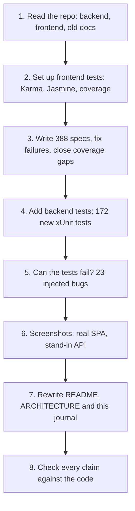

# AI working journal

A running record of **what was asked of the AI, what it produced, what was checked, and what still needs a human decision.**
The rule of the house: you sign off every line you submit, so anything marked *Your call* below is yours to accept, change or reject.
---

## Planning, architecture and design thinking

This section records the initial product and architecture thinking that guided the full-stack implementation. It describes the intended design; individual features and runtime behaviour must still be verified against the current source and by running the application locally.

### Problem understanding and user journeys

The assessment describes a claims lifecycle in which claimants report incidents, follow progress, provide additional information when asked, and receive decisions. Claims staff need to pick up and assess claims, request evidence, progress decisions, and understand workload. Managers need an overview of outstanding work and exposure. I therefore planned the solution around end-to-end user journeys rather than treating the API and UI as unrelated deliverables.

### Architecture choice: one modular monolith

My initial plan was to use one ASP.NET Core Web API backend and one Angular single-page application, with a modular monolith structure. Claimant and staff operations would be exposed through the same API/application deployment, with separate routes, screens, and permissions for each role. The aim was to avoid the operational overhead of microservices during a time-boxed assessment while still separating domain rules, application services, persistence, endpoints, and integration concerns.

The planned frontend has three dashboard experiences:

1. **Claimant dashboard** — submit claims, attach supporting documents, follow claim status, respond to information requests, and view decisions.
2. **Claims staff dashboard** — review incoming or assigned claims, inspect evidence, add assessment comments, request additional documents or information, and record decisions.
3. **Management/overview dashboard** — monitor claim volumes, status distribution, outstanding workload, and exposure indicators where supported by the implemented data.

These are role-oriented views in one Angular application, not three separately deployed applications. The backend remains the source of truth for validation, workflow transitions, and permissions; hiding a button in the UI is not a substitute for server-side authorization.

### Technology choices

- **Frontend:** Angular 17 and TypeScript, using reusable components, shared styling, routing, and API services. The UI should be responsive, readable, accessible, and provide visible loading, empty, success, and error states.
- **Backend:** C# and ASP.NET Core Web API on .NET 8, using REST/HTTP for request-response operations, with business logic kept outside endpoint handlers where practical.
- **Persistence:** EF Core with SQLite for a lightweight local demo, unless the current configuration specifies otherwise.
- **Asynchronous processing:** Kafka is an optional integration for event-driven work. The app should also run locally without Kafka through an in-memory publisher/provider selected by configuration. REST remains suitable for operations that need an immediate result; asynchronous events are appropriate for side effects or projections that can complete after the request.
- **API and developer workflow:** Swagger/OpenAPI for exploration, Git for meaningful changes, and automated tests for domain rules and important API/UI behaviour.

The reason for making Kafka optional is to preserve a low-friction local setup without removing the event-driven design. The two modes must be clearly documented and tested independently. In-memory mode is a development convenience, not durable messaging: in-process messages can be lost if the application stops. Kafka mode requires a reachable broker and correct configuration.

### Data and workflow design

The claim is the central business entity. Supporting documents, information requests, claimant replies, assessments, assignments, and decisions relate to the claim lifecycle. I planned to use explicit workflow transitions and server-side validation so the UI cannot bypass business rules simply by calling an endpoint directly.

Document handling needs particular care because claim creation, document upload, and a reply to an officer's request may be separate HTTP operations. The UI should not report an attachment as uploaded until the API confirms success. If one operation succeeds and a later upload fails, the user needs a clear partial-success message and a retry path that does not create a duplicate claim or duplicate response.

### Design trade-offs and quality attributes

- **Simplicity versus service separation:** one deployable application is easier to run and explain for the assessment; modules and interfaces leave room for later extraction if independent deployment or scaling becomes a real need.
- **REST versus events:** use HTTP for user-visible commands and queries; use events for asynchronous side effects/projections that do not need to block the user request.
- **Local developer experience versus durability:** in-memory messaging helps run without Kafka, but only Kafka provides broker-backed persistence and consumer coordination in this design.
- **Fast delivery versus production hardening:** prioritise core lifecycle and document flows, while recording remaining work such as robust authorization, upload content validation, malware scanning, dead-letter handling, retries, observability, and integration tests.
- **Attractive UI versus functional UI:** visual styling matters, but every interactive control should have a defined action, call the appropriate API when it represents a backend operation, show progress, and surface failures instead of silently pretending success.

### Planned implementation sequence

1. Translate the brief into roles, claim states, key user journeys, and acceptance criteria.
2. Define the modular backend, API contracts, data entities, and the event boundary.
3. Implement claim lifecycle and persistence operations.
4. Build the Angular 17 shell and role-specific dashboard experiences with consistent styling.
5. Connect all UI actions to API services and handle loading, validation, and errors.
6. Add document upload/download and the officer-requested additional-document workflow.
7. Add optional Kafka/in-memory configuration and document how to run each mode.
8. Fix defects found during actual use, then run backend/frontend tests and manually verify critical workflows.

---

## 1. Timeline of session 2: tests, screenshots, documentation



---

## 2. What was asked and what came back

| # | The ask | What the AI produced | Status | Your call |
|---|---|---|---|---|
| 2.1 | "Fullstack project for the assessment: Angular 17 + .NET + Kafka for async; must run with or without Kafka; attractive UI; every button works end-to-end." | Modular monolith, REST for commands/queries, an outbox feeding `IEventPublisher` with in-memory and Kafka providers, plus notification and exposure-projection consumers as the intended design. | **Design recorded; implementation and end-to-end behaviour require local verification.** Check the current source and run the workflows before marking complete. | A configuration switch can keep the application code path consistent across local and Kafka modes; the outbox is intended to reduce the database/event dual-write risk. Confirm the outbox and consumers are implemented before claiming they work. |
| 2.2 | Read the repository, understand the project, and make the README, architecture and AI journal more visual and easier to follow | Three rewritten documents, 8 screenshots, Mermaid diagrams for architecture, lifecycle, sequence, data model and test results | **Verified** against source: endpoints, rules, defaults and file names were checked line by line. Diagrams are PNG images generated with the Mermaid CLI from sources in `docs/diagrams/`, so they look the same in VS Code, GitHub and any viewer. The rendered images were looked at | Read the prose and confirm it says what you would say |
| 2.3 | Test the frontend and report the score | Test runner set up (`karma.conf.js`, `tsconfig.spec.json`, `test` target in `angular.json`, `npm test` and `npm run test:ci`). 388 specs across 16 spec files plus a shared fixtures file | **Verified.** Run in headless Chromium: 388 of 388 pass, 100% statements, branches, functions and lines (573/573, 169/169, 219/219, 467/467), all 22 source files at 100% | Run `npm run test:ci` once on your machine |
| 2.4 | Test the backend and report the score | 172 new xUnit tests in three files (`ClaimStateMachineMatrixTests`, `DomainModelTests`, `EventContractTests`) next to the 20 that already existed, 192 in total. `coverlet.collector` added so `dotnet test --collect:"XPlat Code Coverage"` works | **Partly verified.** 192 of 192 pass, but run through an xUnit-compatible stand-in, not the real xUnit runner (see 3.1) | Run `dotnet test` once. This is the one confirmation the AI could not give |
| 2.5 | Put the percent and score in the README | A scoreboard: pass rate 580 of 580 (100%), frontend coverage 100%, backend coverage **6.4%** overall with a file-by-file map | **Verified** for the numbers; method described in the README | Decide whether you are comfortable showing the 6.4% figure openly (the AI recommends yes) |
| 2.6 | *(AI's own initiative)* Prove the tests can fail | One bug injected at a time: 12 in the frontend, 11 in the backend. Every injected bug turned the suite red, then the file was restored | **Verified.** Results are in the README | None |
| 2.7 | *(AI's own initiative)* Screenshots for the README | 8 PNGs in `docs/images/` | **Partly verified.** Real Angular build, but the data comes from a throw-away stand-in API (3.2) | Retake against the real API if you want them to be fully authentic |

---

## 3. Constraints the AI hit, and what it did about them

### 3.1 The backend could not be restored or built

The sandbox could not reach the NuGet feed, so EF Core, Kafka, xUnit and coverlet could not be installed. A .NET SDK was available from the OS package manager.

Choices made:

| Choice | Reason | Cost |
|---|---|---|
| Compile the **real test files, unchanged,** against a tiny xUnit-compatible stand-in and run them | A test that has been run is worth more than one that has not | Not the real xUnit runner |
| Run them against the production files that need only the .NET base library: `Domain/*`, `Dtos.cs`, `Events.cs` | They are the only ones that can compile without EF Core or Kafka | Anything that touches EF Core or Kafka stays unrun |
| Measure coverage with a small Roslyn instrumenter | coverlet was not available | It reports *statement* coverage, close to but not equal to coverlet's line coverage; no branch or function figures |
| **Do not** commit tests for `ClaimCommands`, `ClaimQueries`, endpoints, handlers or the outbox | They could not be run, and an unrun test may be wrong | Backend coverage is 6.4% overall. The README says so plainly |

### 3.2 The backend could not be started, so screenshots use a stand-in API

A small Node server served the built Angular app and answered `/api/*` with the same JSON shapes and the same business rules (transitions, four-eyes, which buttons each role sees). Data is fictional. It is not part of the repository.

### 3.3 The production build and Google Fonts

`ng build` (production) tries to inline the Google Fonts stylesheet at build time and the sandbox blocks that request. With font inlining temporarily switched off, the production build compiles (277 kB initial, 79 kB gzipped) and the config was then restored. On a normal machine with internet access this is not an issue.

---

## 4. Things the AI got wrong along the way

Mistakes are useful evidence of why human review matters, so they are kept here.

| Where | Mistake | How it was caught | Fix |
|---|---|---|---|
| Frontend interceptor spec | Passed an `unknown` value where the compiler needed a body type | TypeScript error TS2345 | Typed the helper's argument |
| Routing spec | Asserted 8 lazy routes; the app has 9 | Test failed | Corrected to 9 |
| Claims list and dashboard specs | 13 failures: the test module was configured twice, and a periodic timer leaked out of a `fakeAsync` block | Test failures with a clear message | Reset the module in setup; switched to an async boot with a short real wait |
| Coverage | 8 defensive branches (for example "page rendered before data arrives") were uncovered | Coverage report | Wrote specs for those paths rather than excluding them |
| Coverage | The shared fixtures file counted towards coverage and flattered the number | Looking at which files were in the report | Excluded `src/testing/**` |
| Backend coverage tool | Two bugs in the instrumenter, and a rebuild that **silently reused an old binary** because the tool project was compiling its own output folder | The numbers did not change after a fix, which was suspicious | Excluded output folders from compilation; re-ran from clean |
| First draft of ARCHITECTURE.md | Said unreadable event JSON counts as "processed" (only a literal `null` does; bad JSON is retried then skipped). Said the API trusts the SPA's threshold (it is the other way round). Said the relay retries every 2 s (a publish attempt first times out after 8 s) | Re-reading the draft against `Messaging.cs` and the SPA source | Corrected before delivery |
| Screenshot data | A claimant from Malaysia had claims in Thailand | Looking at the images | Aligned claim market with claimant market |

---

## 5. Issues found in the existing project

These were **not** changed in the code. They are listed so you can decide.

| # | Where | Observation | Impact | Suggested action | Your call |
|---|---|---|---|---|---|
| 5.1 | `Infrastructure/Messaging.cs` | After 3 failed attempts an event is logged and skipped, and in Kafka mode the offset is still committed, so the event is dropped for good | Medium. A permanent bug in a handler silently loses notifications | Dead-letter topic and an alert (already listed as a shortcut) | [ ] |
| 5.2 | In-memory mode | Events already stamped as sent but still in the in-process channel are lost if the process stops. The old docs implied the outbox covered restarts; it covers only events not yet sent | Low (development mode) | Say so (done in ARCHITECTURE.md, 4.7) or use Kafka | [ ] |
| 5.3 | Frontend `claim-detail.component.ts`, `dashboard.component.ts` | The 50,000 threshold is written into the SPA (one constant and three text strings, in two files) although `GET /api/system/info` already returns `approvalThreshold` | Medium. Change it on the server and the UI text goes stale | Read the value from the API | [ ] |
| 5.4 | `Application/ClaimQueries.cs` | The dashboard's open-claim counts are live, but its exposure totals come from the asynchronous projection, so the two can briefly disagree | Low. The UI shows "Exposure updated X ago" | Keep, or compute both from one source | [ ] |
| 5.5 | `Infrastructure/Handlers.cs` | `ExposureProjector` loads every claim in a (market, type) bucket on each event | Low now, grows with data | Aggregate in SQL or incrementally | [ ] |
| 5.6 | `Infrastructure/Messaging.cs` (comment on `OutboxDispatcher`) | The comment mentions a `ClaimService` that no longer exists; the class is `ClaimCommands` | Cosmetic | Edit the comment | [ ] |
| 5.7 | Old README and ARCHITECTURE | `GET /api/me` and `GET /api/officers` were missing from the API table, and the lifecycle sketch left out the Assessed to UnderReview ("sent back") transition | Documentation only | Corrected in the new documents | done |
| 5.8 | Backend tests | Before this session: 20 tests, all on the state machine. Nothing on the database, HTTP, handlers or outbox | High for a production claim system | API integration tests (see ARCHITECTURE.md, section 10) | [ ] |

---

## 6. Decisions the original AI made that you should confirm or change

Carried over from the first session, with additions from this one.

- [ ] Modular monolith rather than separate notification and reporting services
- [ ] SQLite with in-memory decimal aggregation (fine for a demo, not for production)
- [ ] The $50,000 manager-approval threshold (an invented business rule)
- [ ] Exposure = approved, else assessed, else claimed, while a claim is open
- [ ] Demo header-based authentication instead of JWT
- [ ] Retry 3 times then log, instead of a dead-letter topic
- [ ] **New:** seven dev dependencies added to the SPA (`karma`, `karma-chrome-launcher`, `karma-coverage`, `karma-jasmine`, `karma-jasmine-html-reporter`, `jasmine-core`, `@types/jasmine`); review `package.json`
- [ ] **New:** `coverlet.collector` 6.0.2 added to the backend test project
- [ ] **New:** `.gitignore` entries for `coverage/`, `out-tsc/`, `TestResults/`
- [ ] **New:** showing the backend figure as 6.4% overall (not only "100% of what is tested")
- [ ] **New:** screenshots taken against a stand-in API

---

## 7. Verification ledger

Everything stated in the README, with how it was established.

| Claim | Evidence | Status |
|---|---|---|
| Frontend: 388 of 388 specs pass | `ng test` in headless Chromium, run several times in this session, final clean run 28 Oct 2026 | **Verified** |
| Frontend coverage 100% (573/573, 169/169, 219/219, 467/467) | `karma-coverage` summary; all 22 files at 100% | **Verified** |
| Frontend tests catch bugs (12 of 12 injected bugs caught) | Mutation run, results kept | **Verified** |
| Backend: 192 of 192 tests pass | Real test files, stand-in runner | **Partly verified** |
| Backend coverage 6.4% (38 of 593 statements) | Roslyn statement instrumenter over all 13 backend files | **Partly verified** (method differs from coverlet) |
| Backend tests catch bugs (11 of 11 injected bugs caught) | Mutation run, results kept | **Verified** (in the stand-in runner) |
| Angular production build compiles | Build run with font inlining disabled | **Verified**, apart from the network-only font step |
| The whole .NET API builds and starts | Not possible in the sandbox | **Not verified** |
| End-to-end demo script, with and without Kafka | Not possible in the sandbox | **Not verified** |
| Docs match the code | Checked against source while writing; errors in the AI's own drafts were found and fixed (section 4) | **Verified**, but a second human read is worthwhile |
| Diagrams are visible in any viewer | Rendered to PNG with the Mermaid CLI and embedded as images; the page was also rendered with a plain Markdown engine that has no Mermaid support, to mimic VS Code's preview | **Verified** |

### Still to run on your machine

- [ ] `cd backend && dotnet build && dotnet test` (expect 192 passing)
- [ ] `cd backend && dotnet test --collect:"XPlat Code Coverage"` (expect a figure near 6%)
- [ ] `cd frontend && npm install && npm run test:ci` (expect 388 passing, 100% coverage)
- [ ] `cd frontend && npm run build`
- [ ] The README's 3-minute tour, once with `Messaging:Provider=InMemory` and once with Kafka

---

## 8. What worked when working with the AI

- **Ask for evidence, not assertions.** Every number in the README traces back to a command that was run. Where something could not be run, the document says so.
- **Make the tests prove they can fail.** All 23 injected bugs were caught; injecting them is the only way to know a suite is not hollow.
- **Say what is missing.** With no package feed, the choice was between a flattering coverage figure and an honest one. The honest one is in the README.
- **Re-read the AI's prose against the code.** Even careful drafts contained wrong statements (section 4). Documentation is the place where plausible-sounding errors hide.
- **Treat the AI's own mistakes as a log, not an embarrassment.** They show where review pays off.

---

## 9. Your own entries

Add a row each time you ask the AI for something and decide what to do with the answer.

| # | Prompt / ask | AI output | Accepted / challenged / overrode | Reasoning |
|---|---|---|---|---|
| 1 | "Fullstack project for the assessment: Angular 17 + .NET + Kafka for async; must run with or without Kafka; attractive UI; every button works end-to-end." | Modular monolith, REST for commands and queries, an intended outbox-to-`IEventPublisher` path with in-memory and Kafka providers, and notification/exposure-projection consumers | Accepted as the target design; implementation and runtime behaviour still need local verification | One configuration switch can keep the same application code path for local in-memory mode and Kafka mode. The outbox is intended to reduce dual-write risk, but it should only be described as implemented after checking the code and tests. |
| 2 | *(for example: "Why a monolith? Argue the case for two services.")* | | | |
| 3 | *(for example: "Walk me through what happens if Kafka is down mid-request.")* | | | |


## 10. Session 3: architecture and design thinking — new-claim supporting documents

**Prompt / goal:** Review the Claims Platform against the assessment dimensions, beginning with planning architecture and design thinking, and add supporting-document upload to the new-claim journey.

### 10.1 Planning architecture and design thinking

**Problem statement.** A claimant should be able to submit a new claim and optionally attach supporting evidence in the same user journey. Staff must later be able to see and download the uploaded files. This is an end-to-end workflow, not only a file-picker UI change.

**Current design observed in the repository.** The application is a modular monolith: an Angular SPA calls an ASP.NET Core .NET 8 API over REST; application commands and queries are separated; domain claim lifecycle rules are represented by a state machine; EF Core persists data to SQLite by default; event publishing/outbox infrastructure supports in-memory development mode and Kafka. Document upload is exposed through the claims API, and the Angular API service sends files as `multipart/form-data`.

**Chosen flow for the new-claim feature.** Validate the claim form and selected files in the browser; create the claim first to obtain its ID; then upload each selected file against that claim ID; navigate to claim details only after the upload sequence succeeds. This reuses the existing claim-document API and avoids inventing a separate upload subsystem for the first version.

**Trade-offs and risks to review.**
- Claim creation and file uploads are separate HTTP operations, so they are not one atomic transaction. If a file upload fails after the claim is created, the claim may exist without all its attachments. The UI should make this partial outcome clear and support retrying uploads without accidentally creating duplicate claims.
- Client-side extension/size checks improve UX but are not a security boundary. The API must independently validate file size, content/type, authorization, and safe storage names; production storage should be private and malware scanning considered.
- Multiple uploads are currently coordinated from the browser. For large files or stronger reliability, consider a server-side upload session, per-file status, idempotency, and cleanup of abandoned uploads.
- The current API is a demo-style modular monolith. Split into services only if independent scaling, ownership, deployment, or security boundaries justify the added operational complexity.

**Decision status:** Proposed implementation and reasoning recorded; the user should verify the code and own the final trade-offs. The full API build and end-to-end upload/download journey have not been independently verified in this environment.

### 10.2 Assessment dimensions — initial review

| Dimension | Initial assessment | Evidence / next step |
|---|---|---|
| Planning architecture and design thinking | Good foundation: modular monolith, clear domain lifecycle, REST commands/queries and event/outbox boundary. | Document the claim + document workflow, partial-failure handling, security and trade-offs. |
| Service and API design | REST endpoints are grouped around claims and role workflows; document upload uses multipart form data. | Add/verify consistent validation errors, status codes, API contract tests, and upload/download authorization tests. |
| Clean architecture and engineering discipline | Domain, Application, Infrastructure and Endpoints are separated. | Review dependency direction, keep business rules out of endpoints, and run formatter/analyzers/build in CI. |
| Backend test automation | Existing journal records 192 tests as partly verified through a stand-in runner; real `dotnet test` was not run in the earlier environment. | Run real restore/build/test locally; add API integration tests for persistence, document endpoints, and partial failures. |
| Data and integration implementation | EF Core/SQLite plus outbox and in-memory/Kafka publishers; exposure projection is asynchronous. | Test restart/retry behaviour, outbox publishing, projection consistency, and document metadata/file persistence. |
| Backend functional components | Claims, assignments, information requests, assessment/approval/rejection/settlement, notifications and workload are represented. | Validate authorization and all lifecycle transitions through HTTP-level tests. |
| Frontend test automation | Existing journal records 388 specs and 100% coverage for the prior snapshot. | Re-run tests after the new-claim document changes; add tests for multiple files, invalid files, upload failure, and retry. Do not assume prior figures still apply. |
| MFE architecture and component design | Current app appears to be one Angular SPA with lazy-loaded routes and shared components, not a micro-frontend system. | This is appropriate for the current scope; introduce MFEs only if separate teams/releases require independent deployment. |
| State management and data flow | Angular services/RxJS and component-level state/signals are used; API service centralizes HTTP calls. | Define explicit loading/error/partial-success states for claim creation plus uploads; avoid duplicating server state. |
| Theming, accessibility and UX design | Shared SCSS tokens and reusable UI components provide a consistent visual base. | Audit keyboard navigation, labels, focus states, contrast, screen-reader announcements, and mobile upload experience. |
| Frontend functional components and collaboration | Feature components are separated by page and shared UI primitives; API/auth/toast services are centralized. | Add end-to-end acceptance tests across claimant and staff roles; ensure upload state and staff document listing agree. |

### 10.3 AI journal entry

| # | Prompt / ask | AI output | Accepted / challenged / overrode | Reasoning |
|---|---|---|---|---|
| 2 | "Analyse the project against architecture, API design, clean architecture, testing, data/integration, backend/frontend components, MFE, state flow, accessibility and collaboration. Start with planning architecture and design thinking; add new-claim supporting document upload." | Recorded the current architecture, proposed the create-claim-then-upload flow, captured trade-offs and listed validation work across the requested dimensions. | Human review pending | The first priority is a clear, explainable design and an honest verification record. The upload flow reuses existing APIs, but claim creation plus uploads is not atomic and must be tested for partial failure. |

## 11. Session 4: full-stack requirements, paging fix, and officer-requested documents

### 11.1 Full-stack scope requested

**Prompt / goal:** Build the Chubb APAC Claims Platform as a full-stack application using Angular 17 and .NET, with Kafka for asynchronous operations, but make it runnable with or without Kafka. The frontend should have an attractive, consistent UI and each visible operation should be wired through to the backend rather than being a decorative button.

**Design response:** Keep one modular monolith and a shared REST API, with role-specific claimant, staff, and management dashboard views. Keep Kafka behind a messaging abstraction and a configuration switch, with an in-memory provider for local development without a broker. Use HTTP for interactive claim operations and events for asynchronous work that can safely complete after the request.

**Verification status:** This records the requested design and intended behaviour, not a claim that every control or both messaging modes have been independently tested. Run the app locally and exercise the key workflows before treating them as verified.

### 11.1.1 Requested versus returned — architecture summary

| # | What was asked | What came back | Acceptance / verification | Reasoning / trade-off |
|---|---|---|---|---|
| 1 | Full-stack assessment using Angular 17 + .NET, with Kafka for asynchronous work; application must also run without Kafka; attractive UI; every button should work end-to-end. | One modular monolith: Angular frontend, one ASP.NET Core Web API, and a shared REST API surface for claimant, staff, and management experiences. | Accepted as the design direction. Confirm actual routes, API wiring, and UI operations in the current source and local run. | A single deployment is simpler to build and explain within the assessment timebox than independently deployed microservices. Role-specific screens can still use server-side authorization. |
| 2 | Support asynchronous processing with Kafka without making Kafka mandatory for local development. | An `IEventPublisher` abstraction with configuration-selected in-memory and Kafka providers was proposed. | Verify the provider switch, startup behaviour with Kafka disabled, and event processing with a reachable broker. | Keeps application code less coupled to the broker and makes local development easier; the in-memory provider does not prove production delivery guarantees. |
| 3 | Handle event publishing reliably and support notifications and exposure projections. | An outbox feeding `IEventPublisher`, with notification and exposure-projection consumers, was described as the intended architecture. | Do not mark as verified until the outbox persistence, dispatcher, consumers, retries, and failure paths are inspected and tested. | The outbox pattern is intended to reduce the database/event dual-write problem, but adds processing and operational complexity. |
| 4 | Provide an attractive UI and make all visible actions functional end-to-end. | Three role-oriented dashboard experiences: claimant, claims staff, and management/overview, using shared frontend services and backend APIs. | Verify each major workflow in the browser and confirm the corresponding API request and persisted result. | Visual polish alone is insufficient; loading, validation, error, success, and partial-failure states should be clear. |

**Important distinction:** This table records what was requested and the architecture returned by the AI/coding session. It is not evidence that each feature is complete. Keep claims about implementation, test counts, Kafka operation, and end-to-end behaviour aligned with results actually observed locally.

### 11.2 Bug: omitted paging query parameters caused HTTP 400

**Observed error:** `BadHttpRequestException: Required parameter "int Page" was not provided from query string.` The workload page called `GET /api/claims` without `page`, and ASP.NET Core Minimal APIs treated the non-nullable paging fields on the query DTO as required.

**Proposed fix recorded from the coding session:** Change `ClaimQuery.Page` and `PageSize` to nullable integers, then apply defaults and bounds in the query handler:

```csharp
public int? Page { get; set; }
public int? PageSize { get; set; }

var pageSize = Math.Clamp(q.PageSize ?? 10, 1, 50);
var page = Math.Max(1, q.Page ?? 1);
```

This keeps the query parameters optional while preserving safe defaults (page 1, page size 10) and clamping page size to 1–50. The error log identifies the failure; the fix should be confirmed by calling `GET /api/claims` with no query string, with `?page=2`, and with invalid/small/large page sizes. Do not delete the local database to resolve this request-binding error; it is unrelated to stored data.

**Status:** Fix described in the coding session; current local source and runtime behaviour still need confirmation.

### 11.3 Feature: claimant uploads additional documents requested by an officer

**Prompt / goal:** When a claims officer adds a comment/request asking for additional documents, the claimant should be able to upload the requested files from that information-request thread.

**Intended backend behaviour:** Provide a document service responsible for validating and storing files and exposing upload/download operations. Uploads should be associated with the relevant claim and information request, and allowed only for the claimant workflow when the officer's request is still pending. The API must validate file size/type and access rules independently of frontend checks.

**Intended frontend behaviour:** Show the request/comment thread and a clearly labelled upload area, with drag-and-drop as an enhancement, selected-file details, progress or busy state, success/error feedback, and retry where safe. Add download access for authorised users. The Angular API service should send the file as `multipart/form-data` to the backend document endpoint.

**Failure cases to test:**
- A claimant can upload against an open/pending request, but cannot upload against an unrelated claim or a closed/completed request.
- Invalid file type and oversize files are rejected by both UI feedback and server validation.
- A failed upload is shown as failed, not as attached; retry does not create duplicate metadata or duplicate replies.
- Staff can view/download the resulting document if their role permits it.
- Unauthorized callers cannot upload, download, or delete documents by guessing an ID.
- File storage and document metadata remain consistent if the database operation or file operation fails partway through.

**Status:** The coding session reported that backend document endpoints/service were wired and frontend models, API calls, and upload UI were being added. This journal does not independently verify those changes; inspect the current source and execute the scenarios above.

### 11.4 AI journal entry: what was accepted and what needs human sign-off

| # | Prompt / ask | AI output / change described | Accepted / challenged / overrode | Reasoning and verification |
|---|---|---|---|---|
| 3 | "Build the full-stack assignment with Angular 17, .NET, optional Kafka, attractive UI, and working frontend-to-backend actions." | Modular monolith, shared REST API, role-specific dashboard views, and Kafka/in-memory messaging modes. | Human review pending | Keep complexity proportionate to the assessment. Verify both configurations and every important UI action locally. |
| 4 | "Fix `Required parameter int Page was not provided` on `GET /api/claims`." | Make `Page` and `PageSize` nullable and apply defaults/clamping in `ClaimQueries.ListAsync`. | Proposed fix; local runtime check pending | Query parameters should be optional; test missing and supplied values. This is request binding, not a database corruption issue. |
| 5 | "If an officer requests additional documents in a comment, let the claimant upload them." | Document service/endpoints and an upload area in the information-request thread, with API integration and validation. | Human review pending | Upload must be associated with the correct pending request, authorization must be enforced server-side, and partial failures/retries must be handled explicitly. |

### 11.5 Local verification checklist before pushing to Git

- [ ] Run the backend and frontend using the documented local instructions.
- [ ] Call `GET /api/claims` without `page` or `pageSize`; confirm it succeeds and returns the default page.
- [ ] Test pagination with explicit values and confirm page size is bounded.
- [ ] Run once with Kafka disabled/in-memory mode and verify core flows work.
- [ ] Run with Kafka enabled and a reachable broker; verify asynchronous events are consumed and failures are observable.
- [ ] Submit a claim with one or more documents and confirm the files can be viewed/downloaded by authorised staff.
- [ ] Have staff request additional documents; as claimant, upload through the request thread and confirm the file is linked to the correct request.
- [ ] Test invalid files, failed uploads, retries, closed requests, and unauthorized access.
- [ ] Re-run backend and frontend tests after the changes; update README/journal numbers only from actual command output.
- [ ] Review `git diff`, remove secrets/local databases/build outputs from the commit where appropriate, and commit the journal with the code changes.

