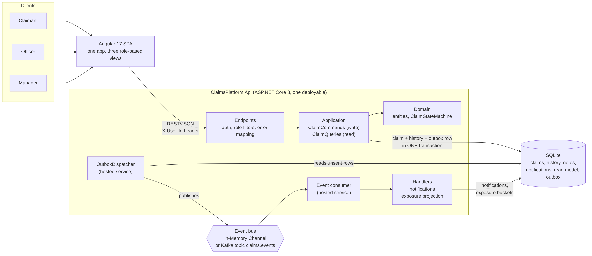
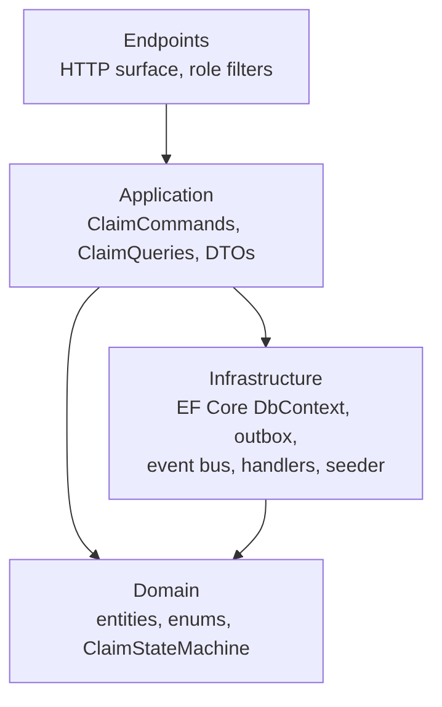
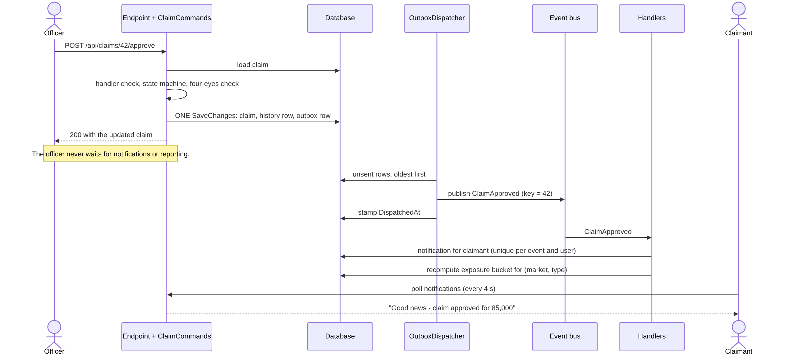
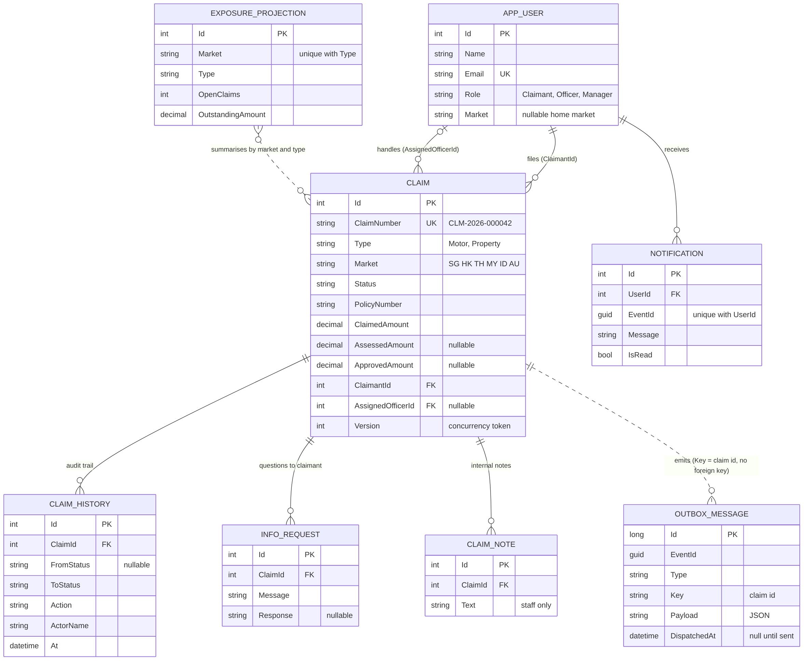
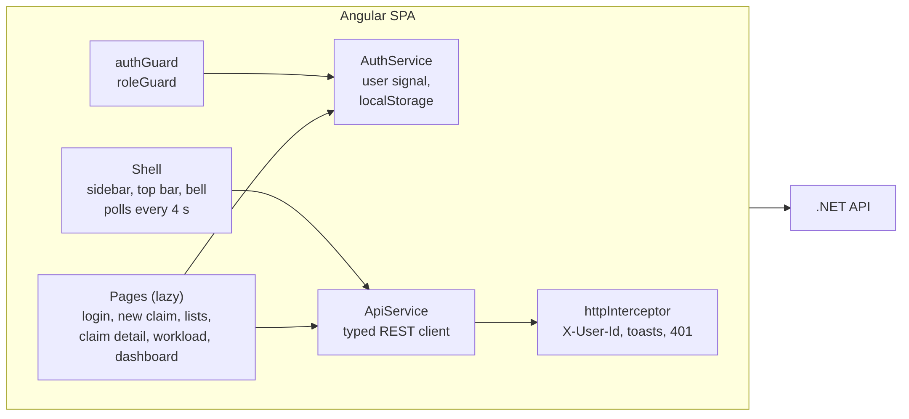
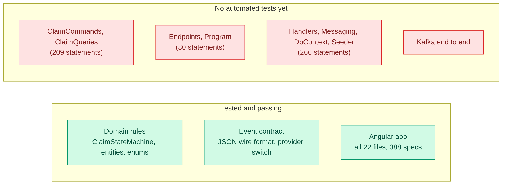

# Architecture

How Claims Desk is put together, why it is shaped that way, and what would change in production.
Start with section 1 if you only have two minutes.

**Contents**

1. [At a glance](#1-at-a-glance)
2. [One service or many?](#2-one-service-or-many)
3. [Synchronous or event-driven?](#3-synchronous-or-event-driven)
4. [The event pipeline](#4-the-event-pipeline)
5. [Business rules](#5-business-rules)
6. [Data model](#6-data-model)
7. [Frontend](#7-frontend)
8. [Testing strategy](#8-testing-strategy)
9. [Shortcuts and the production answer](#9-shortcuts-and-the-production-answer)
10. [What to do next](#10-what-to-do-next)

---

## 1. At a glance

| Question | Short answer |
|---|---|
| What is deployed? | One .NET service plus the static Angular app. Kafka is optional. |
| How do the two halves talk? | REST/JSON. The browser polls every few seconds; there is no websocket. |
| Where does the money logic live? | `Domain/ClaimStateMachine.cs`: pure functions, no I/O, easy to test. |
| What is asynchronous? | Notifications and the exposure (outstanding liability) read model. |
| What guarantees an event is not lost? | The transactional outbox: the event is saved in the same transaction as the state change. |
| What happens without Kafka? | An in-process `Channel<T>` carries the same events through the same outbox and handlers. |

---

## 2. One service or many?

**Decision: a modular monolith with seams where it could be split.**

The arrows show who knows about whom. `Domain` knows nothing about anyone else, which is why its rules can be tested with plain objects. `Application` uses the EF Core `DbContext` directly (EF is treated as the repository) rather than hiding it behind another interface; that is a pragmatic choice for a service this size.

**What drove the decision.** A claim's lifecycle is a single consistency boundary: the state change, its audit row and its event must commit together. Splitting "claims" from "assessment" into two services would turn every transition into a distributed transaction for no business benefit.

The concerns that genuinely differ in *profile* are **notifications** and **exposure reporting**: they are write-light, tolerant of a few seconds of delay, and fan out from claim changes. Those are already isolated behind `IClaimEventHandler`, so either can be moved into its own worker (own consumer group, own database) by moving a class, without touching claim code.

| Part | Folder | Depends on |
|---|---|---|
| Rules and entities | `Domain/` | nothing |
| Use cases | `Application/` | Domain, Infrastructure (DbContext, event JSON) |
| Persistence and messaging | `Infrastructure/` | Domain |
| HTTP surface | `Endpoints/` | Application, Domain |
| Composition root | `Program.cs` | everything |

---

## 3. Synchronous or event-driven?

| Concern | Style | Why |
|---|---|---|
| Submit, assign, assess, approve, reject, settle... | **REST, synchronous** | The caller needs an authoritative answer right now: did it work, am I allowed? Validation, the state machine and the audit row commit in one transaction. |
| Reading claims, workload, detail | **REST** | Plain request/response, easy to filter and page. |
| Notifications to claimants, officers and managers | **Event** | Nobody is waiting for it, a failure must not fail the transition, and more consumers may want it later (email, SMS). |
| Outstanding-exposure numbers | **Event, then a read model** | Reporting load must not slow an officer's write path; a few seconds of staleness is acceptable (the UI says "Exposure updated 2 min ago"). |

A rule of thumb used throughout: **if the user is waiting on the answer, it is synchronous; if the answer is a side effect, it is an event.**

---

## 4. The event pipeline

### 4.1 Components

| Piece | File | Job |
|---|---|---|
| `ClaimCommands` | `Application/ClaimCommands.cs` | Checks rules, changes the claim, writes a history row and an `OutboxMessage`, then calls `SaveChanges` **once** |
| `OutboxDispatcher` | `Infrastructure/Messaging.cs` | Background loop: reads up to 50 unsent rows oldest first, publishes, stamps `DispatchedAt`. Sleeps 300 ms when idle, 2 s after an error |
| `IEventPublisher` | `Infrastructure/Events.cs` | The only thing the relay knows about the bus |
| `InMemoryEventBus` + consumer | `Infrastructure/Messaging.cs` | `Channel<EventEnvelope>` drained by a hosted service |
| `KafkaEventPublisher` | `Infrastructure/Messaging.cs` | Idempotent producer, `acks=all`, keyed by claim id, event type and id in headers |
| `KafkaEventConsumer` | `Infrastructure/Messaging.cs` | Creates the topic (3 partitions) if missing, manual offset commit after handlers finish |
| `EventDispatcher` | `Infrastructure/Messaging.cs` | Runs every handler in a fresh DI scope, up to 3 attempts per event |
| `NotificationHandler` | `Infrastructure/Handlers.cs` | Turns events into in-app notifications |
| `ExposureProjectionHandler` | `Infrastructure/Handlers.cs` | Recomputes the (market, claim type) exposure bucket |

### 4.2 What happens when an officer approves a claim

### 4.3 Why an outbox?

Without it, "save the claim" and "publish the event" are two separate writes. If the process dies between them you either have a changed claim nobody heard about, or an announcement for a change that never happened. Writing the event into an `Outbox` table *in the same transaction* as the claim removes that gap. A separate relay then delivers it, as many times as needed, until it is stamped as sent.

Consequence: delivery is **at-least-once**, so duplicates are possible, so every handler has to cope with them.

### 4.4 Making handlers safe to repeat

| Handler | Technique |
|---|---|
| Notifications | `(EventId, UserId)` is a unique index, and the handler checks it first. A redelivered event creates no second notification. |
| Exposure projection | The bucket is **recomputed from the source-of-truth claims**, not adjusted by +/- deltas. Replays and out-of-order delivery are harmless, and a missed event repairs itself on the next one for that bucket. |

### 4.5 Who gets told what

| Event | Notification(s) |
|---|---|
| `ClaimSubmitted` | The claimant ("We received your claim"). Officers with no home market, or whose market matches the claim ("New Motor claim ... in the SG queue") |
| `ClaimAssigned` | The claimant ("Priya Sharma is now reviewing...") and the officer it was assigned to |
| `InfoRequested` | The claimant, with the officer's question |
| `InfoProvided` | The assigned officer |
| `ClaimAssessed` | All managers, **only when** the assessed amount is above the approval threshold |
| `ClaimApproved`, `ClaimRejected`, `ClaimSettled` | The claimant |
| `ClaimWithdrawn` | The assigned officer |
| `ClaimReopened` | Nobody (but the exposure bucket is still refreshed) |

Every event, whatever its type, also triggers the exposure projection.

### 4.6 With or without Kafka

`Messaging:Provider` selects the implementation of `IEventPublisher` and the matching consumer at start-up. The outbox, dispatcher, `EventDispatcher` and handlers are the same code in both modes, so in-memory mode is a faithful local stand-in, not a different path.

| | In-Memory (default) | Kafka |
|---|---|---|
| Infrastructure needed | none | one broker (`docker compose up -d`) |
| Ordering | channel order, one consumer | per claim, because the key is the claim id so all of a claim's events land on one partition |
| Durability of an event after it left the outbox | process memory only | the Kafka log |
| Offset handling | not applicable | manual commit after handlers finish |
| Typical use | development, demos, tests | production-like runs |

### 4.7 When things go wrong

| Failure | What happens |
|---|---|
| Kafka is down when a claim changes | The request succeeds. The row stays unsent in the outbox. The relay's publish attempt times out after 8 s, it logs a warning, waits 2 s and tries again. `GET /api/system/info` shows the backlog in `pendingOutbox`. When the broker returns, events flow in order. |
| API crashes after publishing but before stamping `DispatchedAt` | The event is published again on restart. Idempotent handlers absorb the duplicate. |
| A handler throws | `EventDispatcher` retries the event up to 3 times with 250, 500 and 750 ms back-off. After the third failure it logs an error and **moves on**; the event is skipped. This is the "no dead-letter topic" shortcut in section 9. |
| A payload that deserialises to `null` | Treated as processed, so it cannot block the stream. Unreadable JSON is handled like any other failure: retried, logged, skipped. |
| Two people edit one claim at once | The second save fails the `Version` check and returns `409 "Someone else just updated this claim"`. |
| In-Memory mode and the process stops while events are in the channel | Those events are lost (they were already stamped as sent). Notifications for them are never created; the exposure numbers repair themselves on the next event for that bucket. With Kafka they would still be in the topic. This is why in-memory mode is a development convenience. |

---

## 5. Business rules

### 5.1 Lifecycle

- There are exactly **12 legal transitions**. They live in one dictionary in `ClaimStateMachine`; an illegal one raises `409` naming both statuses.
- **Open** statuses (money may still move): Submitted, UnderReview, InfoRequested, Assessed, Approved. Approved still counts as open because the payment has not gone out yet.
- A claimant can withdraw only until assessment starts. Once a claim is Assessed or Approved, the claimant can no longer withdraw it.

### 5.2 Who may do what

`ClaimStateMachine.AvailableActions(claim, user)` returns the list of actions for one user on one claim. The UI draws buttons from that list, so this table is also what the screen shows.

| Status | Claimant who filed it | Assigned officer | Other officer | Manager |
|---|---|---|---|---|
| Submitted | withdraw | assignToMe, addNote | assignToMe, addNote | assignToMe, assign, addNote |
| UnderReview | withdraw | requestInfo, assess, reject, addNote | addNote | requestInfo, assess, reject, assign, addNote |
| InfoRequested | provideInfo, withdraw | addNote | addNote | assign, addNote |
| Assessed | none | approve, reject, reopen, addNote | addNote | approve, reject, reopen, assign, addNote |
| Approved | none | settle, addNote | addNote | settle, addNote |
| Rejected, Settled, Withdrawn | none | none | none | none |

Someone else's claim offers a claimant nothing at all (and the API answers `404`, so its existence is not revealed). This table is pinned test-for-test by the 40-row permission table in `ClaimStateMachineMatrixTests`.

### 5.3 Rules enforced in `ClaimCommands`

| Rule | Error |
|---|---|
| Only the assigned officer or a manager may work a claim | 403 |
| Approving more than **50,000** needs a manager (four-eyes) | 403 |
| Approved amount cannot exceed the assessed amount | 400 |
| Rejection needs a reason of at least 10 characters | 400 |
| Information request needs at least 5 characters; the reply at least 3 | 400 |
| A new claim needs a policy number, a location, a 10+ character description, an amount above 0 and up to 5,000,000, and an incident date that is not in the future | 400 |
| Only a manager may assign a claim to someone else; only claims staff can be assignees | 403 / 400 |
| Notes can only be added to open claims | 400 |
| A stale write (someone else saved first) | 409 |

### 5.4 Layers of authorisation

1. **Endpoint filter** (`RequireRole`): is there a signed-in user, and is their role allowed on this route? `401` or `403`.
2. **Command check** (`EnsureHandler`, ownership checks): is this *your* claim, are you the assignee or a manager?
3. **State machine**: is this transition legal from here?
4. **Response shaping**: internal notes are removed from the detail of a claim when the caller is a claimant.
5. **UI**: buttons come from `availableActions`; hiding a button is a convenience, never the protection.

---

## 6. Data model

**Reading the diagram.** The first six tables are the *write model*: the truth. `OUTBOX_MESSAGE` is the hand-off area for events. `EXPOSURE_PROJECTION` is the *read model*: a disposable summary that can be rebuilt at any time from claims (`ExposureProjector.RecomputeAllAsync`).

**Outstanding liability** of a claim is `ApprovedAmount ?? AssessedAmount ?? ClaimedAmount` while the claim is open. It is zero once the claim is Settled, Rejected or Withdrawn.

**Indexes follow the officer's questions:**

| Index | Question it answers |
|---|---|
| `Claim (AssignedOfficerId, Status)` | "My open claims" |
| `Claim (Status, CreatedAt)` | "What has waited longest in the queue?" |
| `Claim (ClaimantId)` | "My claims" |
| `Claim (ClaimNumber)` unique | Look-up by the number a human reads out |
| `Notification (UserId, IsRead)` | The bell badge |
| `Notification (EventId, UserId)` unique | Idempotency of the notification handler |
| `ExposureProjection (Market, Type)` unique | One row per bucket |
| `OutboxMessage (DispatchedAt)` | "What still needs sending?" |

**Storage details.** Enums are stored as readable strings, so reordering them in code never corrupts data. Dates are stored UTC and tagged `Kind=Utc` on the way out so the API serialises them with a `Z`. SQLite runs in WAL mode so the background services and requests do not block each other.

---

## 7. Frontend

Angular 17 with standalone components, **signals** for state, the new `@if` / `@for` control flow, lazy-loaded routes, and a hand-written SCSS design system (no UI library). Fonts are DM Sans and Sora.

### 7.1 Routes

| Route | Who | Page |
|---|---|---|
| `/login` | anyone | Pick a persona or type an email |
| `/my-claims`, `/new-claim` | Claimant | Own claims; file a claim |
| `/workload` | Officer | Personal numbers, open claims oldest first, pipeline |
| `/queue` | Officer, Manager | Submitted claims waiting to be picked up |
| `/claims` | Officer, Manager | Every claim with filters and search |
| `/dashboard` | Manager | Portfolio exposure, status mix, team table, high-value claims |
| `/claim/:id` | Any signed-in user | Timeline, amounts, info requests, notes, actions |

`authGuard` sends anonymous visitors to `/login`. `roleGuard(...)` sends a signed-in user with the wrong role to *their own* home page instead of showing an error. Home pages: Claimant `/my-claims`, Officer `/workload`, Manager `/dashboard`.

### 7.2 Cross-cutting behaviour

| Concern | How |
|---|---|
| Identity | `AuthService` keeps the user in a signal, persisted in `localStorage` under `claims.user` |
| Headers | The interceptor adds `X-User-Id` to every request |
| Errors | The interceptor turns every failure into a readable toast (server message first, a friendly fallback second). Status `0` becomes "Can't reach the server. Is the backend running on port 5080?" |
| Signed out by the server | A `401` for a signed-in user (not on the login call) signs them out |
| Background polling | Shell: notifications and system info every 4 s. Dashboard: every 5 s. Claim detail: every 6 s. Polls send `X-Silent` so a failing poll does not spam toasts |
| Money and dates | `MoneyPipe` (compact `$275.9K` style where it helps) and a `timeAgo` helper |

### 7.3 Why polling and not websockets

The data changes on human timescales (a claim is touched a few times a day) and the staleness window is a few seconds. Polling is simple, works through any proxy and needs no extra server component. Server-sent events would be the first upgrade if latency ever mattered.

---

## 8. Testing strategy

Numbers and how to run everything: **[README, Test scoreboard](../README.md#test-scoreboard)**. This section is about *what each layer is for*.

| Layer | What it protects | Status |
|---|---|---|
| Domain rules | The twelve transitions, who sees which buttons, four-eyes, exposure maths | Fully covered, mutation-checked |
| Event contract | Property names, string enums, UTC timestamps, round-trip, forward compatibility, the `Kafka` / `InMemory` switch | Fully covered, mutation-checked |
| SPA | Every page, guard, pipe, service and the interceptor, in a real headless browser | 100% of statements, branches, functions and lines |
| API, database, messaging | Persistence, the outbox, handlers, HTTP status mapping | **Gap**: 555 of 593 backend statements are not exercised by any automated test |
| Kafka end to end | Broker outage and recovery, consumer-group behaviour | **Gap** |

**Why the gap exists.** These layers need EF Core and Kafka packages, and the environment used for this review could not download them, so such tests could not be run, and a test that has never been seen to pass was not committed.

**How to close it:** `WebApplicationFactory<Program>` with a shared in-memory SQLite connection gives full request-to-database tests (`public partial class Program` is already in place for this), and a Testcontainers Kafka test covers "kill the broker, check the outbox drains".

**Mutation spot-checks.** To prove the suites can fail, one deliberate bug at a time was injected (12 in the frontend, 11 in the backend) and the suite was run; every one turned it red. They are listed in the README.

---

## 9. Shortcuts and the production answer

| Shortcut | Why it is acceptable here | Production answer |
|---|---|---|
| `X-User-Id` header as "authentication" | Keeps the demo to one click | OIDC/JWT from the corporate identity provider; roles from claims |
| The SPA hard-codes the 50,000 approval threshold (one constant and three text strings, in two files) | Same number as the backend today | The SPA reads `approvalThreshold` from `GET /api/system/info` (the API already returns it) |
| SQLite, decimals aggregated in memory | Zero setup | SQL Server or PostgreSQL, SQL aggregates or a reporting store |
| One currency (USD) | Keeps maths simple | A currency per claim plus an FX snapshot at event time |
| Dashboard computed on request (except exposure) | Fine for hundreds of claims | Materialise more projections |
| Failed events retried 3 times, logged, skipped | Simple | Dead-letter topic, alerting, replay tooling |
| In-memory bus loses events that were in the channel at a crash | Dev-only mode | Use Kafka |
| `ExposureProjector` recomputes a bucket by reading all its claims | Correct and idempotent | Incremental aggregate in SQL, or a stream processor |
| Notifications are in-app only | Enough to show the pattern | Email, SMS and push consumers on the same topic |
| No evidence uploads | Out of scope | Blob storage, virus scan, reference stored on the claim |
| Everything in one process | One deployable to run | Move consumers into a worker service with its own consumer group |
| Officers see every market | Small team | Per-market data scoping |
| No contract or integration tests | See section 8 | Testcontainers (Kafka and database) end to end |

---

## 10. What to do next

1. **API integration tests** with `WebApplicationFactory<Program>` and in-memory SQLite, then a Testcontainers Kafka test including "kill the broker mid-request" for the outbox.
2. **Real authentication and authorisation**, plus per-market scoping for officers.
3. **Dead-letter topic** with a small replay tool, and metrics on outbox backlog and consumer lag.
4. **SLA tracking**: a consumer that raises an alert when a claim sits in the queue too long.
5. **Fraud scoring** as another consumer of `ClaimSubmitted`.
6. **Cursor paging, ETags, rate limiting** and structured logs with a correlation id from the SPA through to the handlers.
7. **Server-sent events** for the bell and dashboard once polling is no longer enough.
